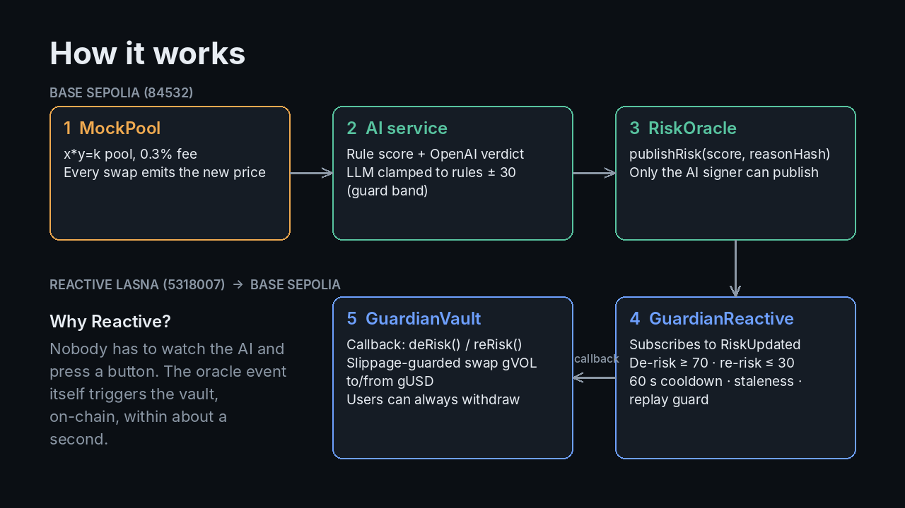

# Guardian Vault

**An off-chain AI scores market risk. A Reactive Network contract reacts to that verdict on-chain and moves a vault out of a crashing token, automatically.**

Built solo for the [Reactive Omni Buildathon](https://dorahacks.io) (DoraHacks, Nov 5 – Dec 5 2026), track **Reactive Meets AI**. Everything runs live on **Base Sepolia** and **Reactive Lasna**. The tokens and the pool are mocks so the scenario is reproducible.

> **Scope: testnet only, mock assets.** This is not a mainnet DeFi product and makes no claim of real liquidity, real funds or audited code. What is real is the Reactive Network loop, the OpenAI call and the on-chain transactions. See [`docs/SAFETY.md`](docs/SAFETY.md).

- Demo video (under 3 min): https://youtu.be/F_FTwyEWA5Y
- Evidence (tx hashes and timings for real runs): [`NOTES.md`](NOTES.md) and [`ai/verdicts.jsonl`](ai/verdicts.jsonl)

## What it does

```
 Base Sepolia                                Reactive Lasna                    Base Sepolia
 MockPool.Swap ─► AI service ─publishRisk─► RiskOracle ─RiskUpdated─► GuardianReactive ─callback─► GuardianVault
 (price moves)    rules + LLM,               (AI signer only)          hysteresis, cooldown,        deRisk() / reRisk()
                  guard band ±30                                       staleness, replay guard      slippage-guarded swap
```

1. Swaps hit a mock x\*y=k pool. Each `Swap` event carries the post-swap price.
2. The **AI service** (Node, `ai/`) turns the recent swaps into computed features, asks OpenAI for a `{score, reason}` verdict, clamps it to the deterministic rule score ± 30, and calls `RiskOracle.publishRisk(score, keccak(reason))`.
3. **GuardianReactive** (on Lasna) subscribes to `RiskUpdated`. It decides, using hysteresis, a cooldown, staleness and replay checks, whether the vault should move, and requests a callback.
4. **GuardianVault** swaps its gVOL (volatile) into gUSD (stable) on `deRisk`, and back on `reRisk`. Only the callback proxy acting for our Reactive contract can trigger either, and the vault does not take the callback on trust: it re-reads `RiskOracle` itself and refuses (`CallbackRejected`) unless the oracle's latest verdict is fresh and really justifies the move.

No keeper bot and no multisig sits between the verdict and the vault. Without a fresh AI verdict nothing downstream moves, so the model is a required part of the running loop.



## Live deployment

| Contract | Chain | Address |
|---|---|---|
| RiskOracle | Base Sepolia (84532) | `0x10E4eF88f1A4f82823198868d99756e0F118FB37` |
| MockPool | Base Sepolia (84532) | `0x9992fB4FF288FA112d1bA4e4d70c67406b58390E` |
| GuardianVault | Base Sepolia (84532) | `0x5E114CE312DACd8e2892967B05891E689CdB89d2` |
| GuardianReactive | Reactive Lasna (5318007) | `0x9992fB4FF288FA112d1bA4e4d70c67406b58390E` |

Base contracts on [sepolia.basescan.org](https://sepolia.basescan.org); the Lasna contract on [lasna.reactscan.net](https://lasna.reactscan.net). AI signer wallet (the only address allowed to publish risk): `0x099538191912fA7Ee4B8574a6Be114276A9bCf9f`.

## Execution evidence (reactive transactions and the callbacks they trigger)

[`NOTES.md`](NOTES.md) lists, for real runs, the full chain for one verdict: trigger swap → AI `publishRisk` tx (Base Sepolia) → Lasna `ActionRequested` reactive tx → vault `DeRisked` / `ReRisked` callback tx (Base Sepolia), each with its tx hash and the seconds between steps. It also holds the first smoke-test loop (origin → reactive → callback). Every verdict the AI published, with its features, score, reason and tx hash, is in [`ai/verdicts.jsonl`](ai/verdicts.jsonl). You can regenerate any of it with `demo/proof.sh <epoch>`.

## Who this is for

Anyone who parks funds in a volatile asset and cannot watch the market all day: a DAO treasury, a vault depositor, a small fund. Today the protection is a keeper bot or a human with a multisig, both of which are slow, trusted and offline when it matters. Here the trigger is a public on-chain verdict, the action is on-chain and rule-bound, and users can always withdraw.

## Results from the recorded run

| | |
|---|---|
| Swap → vault moved, de-risk (epoch 27) | **15 s** |
| of which AI step (poll, features, OpenAI call, tx) | 14 s |
| of which oracle event → Lasna → vault callback | 1 s |
| Vault at the crash bottom (pool price 0.51) | 24.25 gUSD vs 15.01 if it had simply held (**+9.24**) |
| Vault after full recovery | 24.24 vs 29.48 if held (**−5.24**) |

Across runs the AI step took 11–47 s (the re-risk in epoch 30 took 49 s end to end, 2 s of it on-chain); the chain hop was 1–2 s. Latency is dominated by the LLM call, not by Reactive Network.

### What it looks like

Crash, AI verdicts (70, then 100) and the vault de-risking, left pane is the demo, right pane is the AI service:


Recovery, re-risk and the on-chain evidence for one verdict:


### Honest limitations

- **The vault sells after the first drop, not before it.** It limits further loss; it does not predict the crash.
- **The round trip costs.** After the pool fully recovers the vault is below plain holding (−5.24 gUSD above; −6.66 in an earlier run). De-risking trades upside for protection and is not free. In a crash that keeps going it wins clearly (+9.24 here, +11.23 earlier).
- Mock tokens and a thin mock pool: numbers are illustrative. `demo/status.sh` always prints the real difference versus holding.
- LLM output is not deterministic. The guard band and rule score keep the outcome in a sane range, and `ai/verdicts.jsonl` records what the model actually said (it sometimes stays at "danger" after recovery; the guard band corrects it).

## What the Reactive contract decides

- **Hysteresis:** de-risk at score ≥ `HIGH` (70), re-risk only at score ≤ `LOW` (30). Scores in between do nothing, so a score wobbling near one line cannot flip-flop the vault.
- **Cooldown:** no second action within 60 s of the last, measured with `block.timestamp` (Base blocks are ~200 ms, so never count blocks).
- **Staleness:** a verdict older than `MAX_AGE` (600 s) is ignored.
- **Replay protection:** only epochs newer than the last one seen count.
- Skips are reported with a `Skipped` event and a reason code (1 stale epoch, 2 too old, 3 cooldown, 4 no action needed).

## Safety properties (each has a test)

1. `withdraw()` always works, whatever the AI, oracle or Reactive Network do.
2. `deRisk` / `reRisk` revert for anyone except the callback proxy acting for our Reactive contract.
3. Swaps are slippage-guarded against pool spot price (default 10%, owner can raise to at most 50%). A failed guard reverts and leaves state untouched.
4. Stale or duplicate callbacks are ignored (`CallbackIgnored`), not executed.
5. Deposits are paused while risk-off.
6. Only the AI signer can publish risk; the owner can rotate the signer.
7. **Independent verdict check:** before trading, the vault reads the oracle directly. De-risk needs latest score ≥ 70, re-risk ≤ 30, and the verdict must be no older than `MAX_AGE`. Otherwise it emits `CallbackRejected(epoch, reason, oracleScore)` and does not trade, so a wrong, superseded or forged verdict cannot move funds.

The full threat table (wrong AI verdict, OpenAI API failure, stale verdict, replay, unauthorized signer) with the test behind each row and real test output is in [`docs/SAFETY.md`](docs/SAFETY.md). Reproduce it with `demo/safety-proof.sh`.

## The AI service (`ai/`)

```
Swap events ─► features (price path, drawdown, sell streak, impact, speed)
            ─► rule score (deterministic)  ─┐
            ─► LLM score + reason (OpenAI)  ─┴► guard band ─► publishRisk(score, keccak(reason))
```

- **Features, not raw logs.** The LLM receives computed numbers and must answer strict JSON `{score, reason}`. Market data is treated as untrusted input in the prompt.
- **Guard band.** Final score = LLM score clamped to rule score ± 30. The model cannot invent a crash in a calm market or argue the vault out of reacting to an obvious one. If OpenAI is unreachable the rule score is used and the reason says "fallback".
- **Auditable.** Every published verdict is appended to `ai/verdicts.jsonl` (features, rule score, LLM score/model/reason, the full OpenAI request and response, tx hash, epoch). The service also prints each OpenAI exchange live (`SHOW_LLM=0` to silence). The on-chain `reasonHash` is `keccak256(reasonText)`, so anyone can check a logged reason against the chain.
- **Separate wallet.** The service signs with its own key (`npm run keygen`, never printed). Only that address is the oracle's signer.
- **Publish policy** (`src/policy.js`): publish when action is needed, when the score moves ≥ 15, as a heartbeat (keeps verdicts inside `MAX_AGE`), and re-publish while the vault has not yet moved. Rate limit 20 s.

## Run it yourself (WSL / Linux)

Requirements: Foundry, Node 20+, a throwaway wallet with Base Sepolia ETH and lREACT, an OpenAI API key.

```bash
git clone --recurse-submodules <this repo> && cd guardian-vault
forge build
forge test                     # 63 tests
(cd ai && npm install && npm test)   # 33 tests
cp .env.example .env           # fill in as you deploy, then: source .env
cast wallet import testdeployer --interactive   # keys live in a Foundry keystore, never in .env
```

If `forge build` cannot download solc, fetch `solc-static-linux` v0.8.29 from the Solidity releases, `chmod +x` it and run `forge build --use ./solc-static-linux --offline`.

### Deploy

```bash
source .env
forge script script/Guardian.s.sol:DeployMarket          --rpc-url $BASE_SEPOLIA_RPC --account $ACCOUNT --broadcast  # tokens, pool, oracle
forge script script/Guardian.s.sol:DeployGuardianReactive --rpc-url $LASNA_RPC        --account $ACCOUNT --broadcast  # Lasna
forge script script/Guardian.s.sol:DeployVault           --rpc-url $BASE_SEPOLIA_RPC --account $ACCOUNT --broadcast  # vault + callback ETH
forge script script/Guardian.s.sol:LinkVault             --rpc-url $LASNA_RPC        --account $ACCOUNT --broadcast  # one-time link
forge script script/Guardian.s.sol:SeedVault             --rpc-url $BASE_SEPOLIA_RPC --account $ACCOUNT --broadcast  # deposit 100 gVOL
```

`DeployVault` also needs `ORACLE_ADDRESS` (the vault checks it) and, optionally, the same `HIGH_THRESHOLD`/`LOW_THRESHOLD`/`MAX_AGE_SECONDS` as the reactive contract.

Paste each printed address into `.env` and `source .env` again between steps.

### Start the AI

```bash
cd ai && npm run keygen        # creates ai/.env and the AI wallet, prints only the address
# add OPENAI_API_KEY=... to ai/.env; POOL/ORACLE/VAULT are read from ../.env
npm run check                  # one cheap OpenAI call: key and model OK?
cd .. && source .env && AI=0x...   # the address keygen printed
cast send $ORACLE_ADDRESS "setSigner(address)" $AI --rpc-url $BASE_SEPOLIA_RPC --account $ACCOUNT
cast send $AI --value 0.005ether --rpc-url $BASE_SEPOLIA_RPC --account $ACCOUNT
cd ai && npm start             # AI terminal; `npm run dry` evaluates without publishing
```

### Demo

```bash
# the keystore password is needed non-interactively by the demo scripts; delete the file afterwards
printf '%s' 'YOUR_KEYSTORE_PASSWORD' > ~/.guardian-pw && chmod 600 ~/.guardian-pw

demo/run-demo.sh               # whole story with narration (AI service must be running in another pane)
demo/status.sh                 # price, riskOff, holdings, vault value vs holding
demo/staged-crash.sh           # just the staged sells
demo/reset-pool.sh             # bring the pool price back to ~1.0 (stop the AI first)
demo/proof.sh <epoch>          # swap → publish → Lasna reaction → vault callback, with tx hashes and timings
rm ~/.guardian-pw
```

`demo/proof.sh 27 | tee -a NOTES.md` is how the evidence in `NOTES.md` was produced. It reads `ai/verdicts.jsonl` and the chains (public Base RPC limits `eth_getLogs` to ~200 blocks; the script accounts for that).

## Repository layout

| Path | Role |
|---|---|
| `src/MockToken.sol`, `src/MockPool.sol` | test tokens (open mint) and the x\*y=k pool |
| `src/RiskOracle.sol` | AI-signed risk verdicts, emits `RiskUpdated` |
| `src/GuardianReactive.sol` | Lasna decision contract (`AbstractReactive`) |
| `src/GuardianVault.sol` | shares-based vault; `deRisk` / `reRisk` via callback (`AbstractCallback`) |
| `src/Hello*.sol` | first smoke test of the Reactive loop (origin → reactive → callback) |
| `script/` | deploy, link, seed, crash/recover and publish scripts |
| `test/` | 10 hello-loop tests + 53 Guardian tests (mock system contract at `0x8888…8888`) |
| `ai/` | the AI risk service, its tests and `verdicts.jsonl` |
| `demo/` | one-command demo, status, reset and evidence scripts |

Built on `reactive-lib-omni` (Omni fork: no RVM, single deployment, Solidity 0.8.29, system contract `0x8888…8888`).

## Notes for Reactive developers

- The callback is billed in ETH to the **destination** contract; the Reactive contract needs lREACT. Top both up with a plain transfer.
- The first callback argument is overwritten with the Reactive contract's address, so `deRisk` / `reRisk` take it as a placeholder and the vault checks it.
- Base Sepolia public RPC caps `eth_getLogs` at ~200 blocks; Lasna's RPC cannot binary-search from block 1, so `proof.sh` estimates Lasna blocks from timestamps.
- Callback reverts with `NotAuthorized`: wrong proxy address or mismatched reactive address. `callbackSender` is immutable; redeploy the destination if it is wrong.

## License

MIT, see [`LICENSE`](LICENSE).
