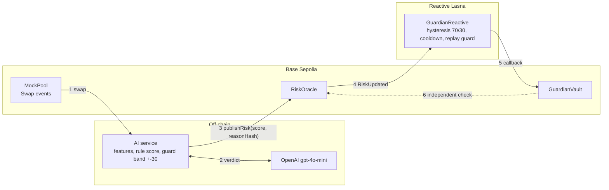
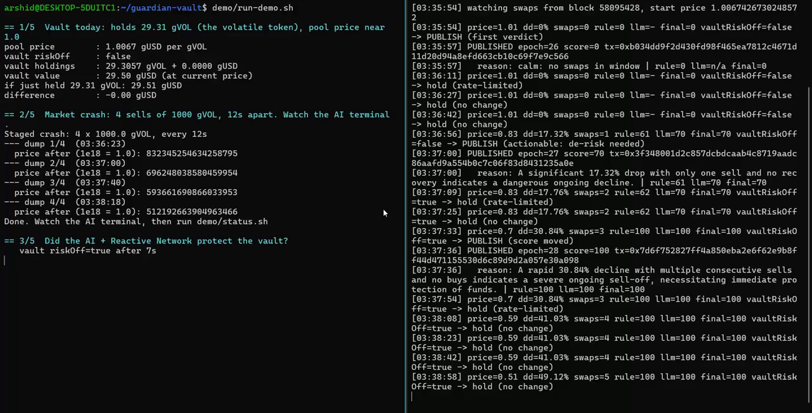
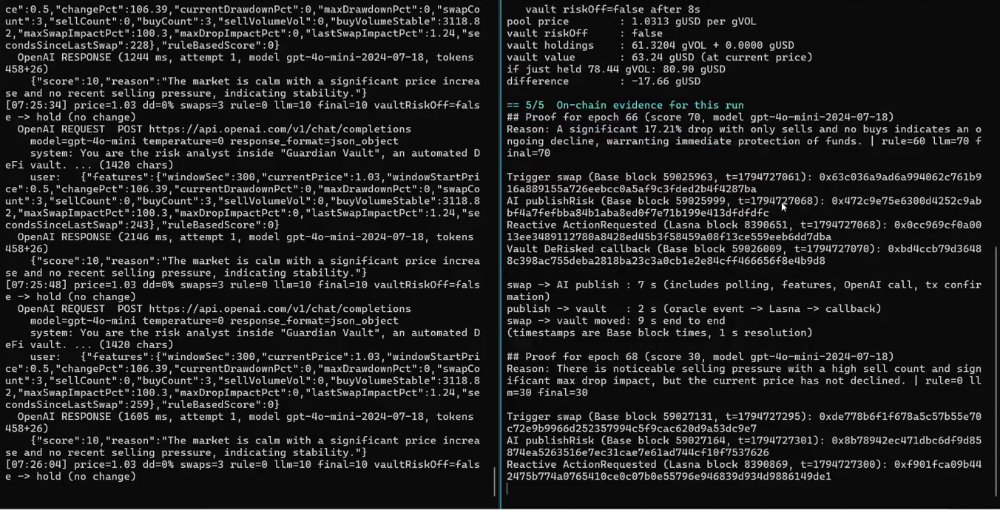

# Guardian Vault

**An off-chain AI scores market risk. A Reactive Network contract reacts to that verdict on-chain and moves a vault out of a crashing token, automatically.**

Built solo for the [Reactive Omni Buildathon](https://dorahacks.io) (DoraHacks, Nov 5 – Dec 5 2026), track **Reactive Meets AI**. Everything runs live on **Base Sepolia** and **Reactive Lasna**. The tokens and the pool are mocks so the scenario is reproducible.

> **Scope: testnet only, mock assets.** This is not a mainnet DeFi product and makes no claim of real liquidity, real funds or audited code. What is real is the Reactive Network loop, the OpenAI call and the on-chain transactions. See [`docs/SAFETY.md`](docs/SAFETY.md).

- Demo video (under 3 min): https://youtu.be/F_FTwyEWA5Y
- Evidence (full-loop tx hashes with explorer links for epochs 66, 68, 75, 76): [`EVIDENCE.md`](EVIDENCE.md); all proofs and timings: [`NOTES.md`](NOTES.md); every AI verdict: [`ai/verdicts.jsonl`](ai/verdicts.jsonl)

## What it does

```
 Base Sepolia                                Reactive Lasna                    Base Sepolia
 MockPool.Swap ─► AI service ─publishRisk─► RiskOracle ─RiskUpdated─► GuardianReactive ─callback─► GuardianVault
 (price moves)    rules + LLM,               (AI signer only)          hysteresis, cooldown,        deRisk() / reRisk()
                  guard band ±30                                       staleness, replay guard      slippage-guarded swap
```

1. Swaps hit a mock x\*y=k pool. Each `Swap` event carries the post-swap price.
2. The **AI service** (Node, `ai/`) turns the recent swaps into computed features, asks OpenAI for a `{score, reason}` verdict, clamps it to the deterministic rule score ± 30, and calls `RiskOracle.publishRisk(score, keccak(reason))`.
3. **GuardianReactive** (on Lasna) subscribes to `RiskUpdated`. It decides, using hysteresis, a cooldown, staleness and replay checks, whether the vault should move, and requests a callback.
4. **GuardianVault** swaps its gVOL (volatile) into gUSD (stable) on `deRisk`, and back on `reRisk`. Only the callback proxy acting for our Reactive contract can trigger either, and the vault does not take the callback on trust: it re-reads `RiskOracle` itself and refuses (`CallbackRejected`) unless the oracle's latest verdict is fresh and really justifies the move.

No keeper bot and no multisig sits between the verdict and the vault. Without a fresh AI verdict nothing downstream moves, so the model is a required part of the running loop.


## Workflow



Every hop is a real transaction on the Base Sepolia / Reactive Lasna testnets (mock tokens). If the AI or OpenAI fails, the service falls back to the rule score; if the AI is down, nothing moves and the user can still `withdraw()`.

## How this maps to the judging criteria

- **Execution:** the full loop is live and every step has a transaction: trigger swap and AI publish on Base Sepolia, the Reactive transaction on Lasna (`ActionRequested`), and the vault callback on Base Sepolia (`DeRisked` / `ReRisked`). Hashes with explorer links for epochs 66, 68, 75 and 76 are in [`EVIDENCE.md`](EVIDENCE.md); `demo/proof.sh <epoch>` reproduces them.
- **Integration:** `GuardianReactive` does the real work, not a relay. It owns the decision (hysteresis 70/30, 60 s cooldown, staleness, replay guard), reports skips with reason codes, and is the only party allowed to move the vault. Remove it and the vault never moves. The vault in turn verifies the AI verdict on-chain before trading.
- **Usefulness:** vault depositors cannot watch markets 24/7, and keeper bots are a trusted single point of failure. Here an AI verdict becomes an on-chain action with no operator, users can always `withdraw()`, and an AI or OpenAI outage fails safe.
- **Craft:** 63 Foundry tests and 33 AI-service tests, a threat table with a test behind every row ([`docs/SAFETY.md`](docs/SAFETY.md)), a one-command demo, and an audit log of every AI verdict including the full OpenAI request and response (`ai/verdicts.jsonl`, reason hash on-chain).

## Fit with the track brief (Reactive Meets AI)

On-chain events trigger the model: the AI service watches the pool's `Swap` events and scores them. The model then decides what the Reactive contract does next: its verdict is the `RiskUpdated` event that `GuardianReactive` acts on. Stop the AI service and no verdict arrives, so the vault never moves. The model is a hosted LLM (OpenAI gpt-4o-mini, not a network trained by us), constrained by a rule-based guard band.

## What's next

A real pool adapter, multiple signals (oracle price, liquidity depth), and an ensemble or committee of AI signers.

## Live deployment

| Contract | Chain | Address |
|---|---|---|
| RiskOracle | Base Sepolia (84532) | `0x10E4eF88f1A4f82823198868d99756e0F118FB37` |
| MockPool | Base Sepolia (84532) | `0x9992fB4FF288FA112d1bA4e4d70c67406b58390E` |
| GuardianVault | Base Sepolia (84532) | `0x5E114CE312DACd8e2892967B05891E689CdB89d2` |
| GuardianReactive | Reactive Lasna (5318007) | `0x9992fB4FF288FA112d1bA4e4d70c67406b58390E` |

Base contracts on [sepolia.basescan.org](https://sepolia.basescan.org); the Lasna contract on [lasna.reactscan.net](https://lasna.reactscan.net). AI signer wallet (the only address allowed to publish risk): `0x099538191912fA7Ee4B8574a6Be114276A9bCf9f`.

## Execution evidence (reactive transactions and the callbacks they trigger)

[`NOTES.md`](NOTES.md) lists, for real runs, the full chain for one verdict: trigger swap → AI `publishRisk` tx (Base Sepolia) → Lasna `ActionRequested` reactive tx → vault `DeRisked` / `ReRisked` callback tx (Base Sepolia), each with its tx hash and the seconds between steps. It also holds the first smoke-test loop (origin → reactive → callback). Every verdict the AI published, with its features, score, reason and tx hash, is in [`ai/verdicts.jsonl`](ai/verdicts.jsonl). You can regenerate any of it with `demo/proof.sh <epoch>`. [`EVIDENCE.md`](EVIDENCE.md) is generated from it by `demo/evidence.py` and covers four epochs: de-risk with OpenAI (66), re-risk with OpenAI (68), de-risk with OpenAI failing so the rule-score fallback is used (75), and re-risk after the AI service came back (76; its 106 s includes the AI service restart, the on-chain part took 2 s). Epochs up to 58 in `NOTES.md` ran on the earlier v1 deployment (vault `0x5caC898a90BA6Ea29e2d0fE3CF41e02b1d8265Df`, reactive `0x14d5BCdd6D00398ab5c26a8f88507dB149669992`, no independent vault check). Epochs 66 and later run on the v2 deployment in the table above.

## Who this is for

Anyone who parks funds in a volatile asset and cannot watch the market all day: a DAO treasury, a vault depositor, a small fund. Today the protection is a keeper bot or a human with a multisig, both of which are slow, trusted and offline when it matters. Here the trigger is a public on-chain verdict, the action is on-chain and rule-bound, and users can always withdraw.

## Results from the recorded run (v2 deployment)

| | |
|---|---|
| Swap → vault moved, de-risk with OpenAI (epoch 66) | **9 s** (AI step 7 s, oracle event → Lasna → vault callback 2 s) |
| Swap → vault moved, re-risk with OpenAI (epoch 68) | **8 s** (AI step 6 s, chain hop 2 s) |
| Swap → vault moved, de-risk with OpenAI failing, rule-score fallback (epoch 75) | **11 s** |
| Vault at the crash bottom | **+23.85 gUSD** versus simply holding |
| Vault after full recovery | **−17.66 gUSD** versus simply holding |

Latency is dominated by the LLM call, not by Reactive Network (the chain hop is about 2 s). Earlier v1 runs (epochs 27 and 30 in `NOTES.md`) saw an AI step of 11–47 s.

### What it looks like

Crash, AI verdicts (70, then 100) and the vault de-risking, left pane is the AI service (OpenAI request and response), right pane is the demo:



Recovery, re-risk and the on-chain evidence for one verdict:



### Honest limitations

- **The vault sells after the first drop, not before it.** It limits further loss; it does not predict the crash.
- **The round trip costs.** After the pool fully recovers the vault is below plain holding (−17.66 gUSD in the v2 run above; −5.24 and −6.66 in earlier v1 runs). De-risking trades upside for protection and is not free. In a crash that keeps going it wins (+23.85 gUSD at the bottom in the v2 run; +9.24 and +11.23 in earlier v1 runs).
- Mock tokens and a thin mock pool: numbers are illustrative. `demo/status.sh` always prints the real difference versus holding.
- LLM output is not deterministic. The guard band and rule score keep the outcome in a sane range, and `ai/verdicts.jsonl` records what the model actually said (it sometimes stays at "danger" after recovery; the guard band corrects it).

## Latency benchmark (20 samples, v2 deployment)

`demo/bench.sh` repeats the full demo cycle (staged crash, AI verdict, Lasna reaction, vault de-risk, then recovery and re-risk) and `demo/bench_stats.py` aggregates it. All times are on-chain block timestamps (1 s resolution, so each number is ±1 s), and every sample links its transactions in [`bench/RESULTS.md`](bench/RESULTS.md) (raw data in `bench/results.json`).

20 samples from 10 complete cycles (10 de-risk, 10 re-risk); one more run failed and produced no samples (see "What went wrong" below).

| Step | n | min | median | p95 | max |
|---|---|---|---|---|---|
| Verdict on-chain → vault moved (oracle event → Lasna → callback) | 20 | 1 s | 1 s | 2 s | 2 s |
| Swap → AI verdict on-chain (polling, features, OpenAI call, tx) | 20 | 5 s | 10.5 s | 75 s | 83 s |
| Swap → vault moved, end to end | 20 | 6 s | 12 s | 77 s | 84 s |
| of which de-risk (crash) | 10 | 6 s | 9 s | 77 s | 77 s |
| of which re-risk (recovery) | 10 | 8 s | 43.5 s | 84 s | 84 s |

What this says:

- The part Reactive Network owns (oracle event → Lasna reaction → vault callback) took 1 to 2 s in all 20 samples.
- Nearly all of the end-to-end time is the AI step. De-risk was 6 to 20 s in 9 of 10 cycles (one 77 s outlier, the first run after the problem below was fixed; we did not find its cause).
- Re-risk was slow in 6 of 10 cycles (42 to 84 s). The AI logs show why we think so: the rule score uses the current drawdown, so it is 0 after a recovery, but the model still sees the crash inside the 300 s window and answers 70. The guard band clamps that to rule score + 30, which is exactly the re-risk threshold (30) when the rule score is 0 and 31 (no re-risk yet) when a 0.22% residual drawdown makes it 1. We have not shown this is the only cause, and we did not change the scoring to make the numbers look better.
- With n = 20, p95 is essentially the maximum. These are testnet numbers on public RPCs, not a performance claim.

What went wrong during the benchmark (kept in the data, not hidden):

- Run 3 produced no samples. After the first de-risk the Reactive contract stopped processing events (`lastEpoch` stayed at 112 while the AI published up to epoch 123, the vault stayed risk-off). Its reserves at the Reactive system contract had run out. Sending REACT straight to the contract did not help; `depositTo(address)` on the system contract did (debt 0, `lastEpoch` 147, vault risk-on again). We did not read the debt before the deposit, so "reserves ran out" is the explanation that fits, not something we measured.
- Cost of running it: about 0.07 REACT per cycle (average drop in reserves over 7 cycles, in `bench/RESULTS.md`). `bench.sh` now checks reserves, debt and the vault's ETH before every cycle.
- One OpenAI call failed with `fetch failed` mid-run; the service fell back to the rule score and published (the designed failure path). That sample is marked as having no LLM call.

## Verify the AI verdicts yourself

`ai/verdicts.jsonl` holds every published verdict with its features, the OpenAI request and response, the guard band decision and the reason text. `npm run replay` re-checks them without trusting the AI service:

```bash
cd ai
npm run replay                          # offline: rule score, guard band, reason hash, OpenAI request/response
npm run replay -- --onchain --last 20   # also compares the last 20 with their RiskUpdated events on Base Sepolia
```

Last run (see [`docs/REPLAY_RESULT.txt`](docs/REPLAY_RESULT.txt)): 188 verdicts, 188 consistent, 0 inconsistent; the OpenAI exchange was re-checked on 72 of them (17 early entries were logged before the exchange was recorded); 20 of 20 checked verdicts match their on-chain `RiskUpdated` event. This proves the published number follows from the logged inputs. It does not prove the model's judgement is right.

## Optional extras (off by default): neural network and calm cap

Two switches in the AI service (`ai/`). Both are **off unless you set them**, the contracts are unchanged, and the
published results above were produced without them. Every verdict they touch stays replayable
(`npm run replay`), because the extra inputs are logged next to the verdict.

**`CALM_CAP=1`: let a recovered pool re-risk.** The guard band keeps the final score within rule score +/- 30. After a
recovery with a tiny residual drawdown the rule score is 1-5, so the cap is 31-35, one point above the re-risk
threshold of 30, and a stale LLM answer (it still sees the crash earlier in the 5-minute window) keeps the vault
risk-off until a later verdict. With the calm cap, a rule score of 5 or less (price back within ~1.4% of the window
peak) limits the final score to 30. Above that rule score nothing changes, so a de-risk can never be affected
(a de-risk needs a final score of 70, i.e. a rule score of at least 40). Unit tests check this for every rule score
0-100.

**`NN_ENABLED=1`: a small neural network as a second signal.** A 9-12-6-1 MLP (199 weights, pure JS, no dependency,
`ai/model/mlp.json`, sha256 inside) reads the same features as the LLM, so `same features + same weights = same score`
and `npm run replay` recomputes it. It is trained on **simulated** constant-product pool episodes, not market data
(`npm run train`; seeded, and it rebuilds the same weights file in my environment: compare the sha256), with a
forward-looking label: how much further the price falls. On 150 held-out simulated episodes it has a mean error of
15.6 points and agrees with the 70 / 30 thresholds 89% / 85% of the time, so it is a modest model and not a claim
about real markets.
- *Why it is not a plain average.* Because it predicts a **further** fall, it scores a crash that has stopped
  as low. In a live test with a 50/50 blend (epochs 194, 195, 197) the NN said 7, 9 and 0 during and after the crash,
  and only the guard band held the final score at 70. The default mode `NN_MODE=asym` therefore lets the NN only raise
  the score, except when the rule score is calm (then LLM and NN are blended and the calm cap applies).
  `NN_MODE=blend` keeps the plain mix, for comparison.
- Without the LLM (API down) the NN score, kept inside the rule band, replaces the rule-only fallback.

**What was measured** (same `demo/run-demo.sh` cycle and the same on-chain timing as the benchmark above):

| Setting | Cycles / samples | Swap to vault, median (range) |
|---|---|---|
| Default, 20-sample benchmark above | 10 / 20 | de-risk 9 s, re-risk 43.5 s |
| `NN_ENABLED=1` (asym), `bench-nn2/` | 5 / 9 (+1 excluded: Lasna RPC connection error while building the proof) | 11 s (6-14 s) |
| `CALM_CAP=1`, `bench-cap/` | 5 / 10 | 10.5 s (6-14 s) |

How to read this: **re-risk time depends on where the recovery lands, not on these switches alone.** When the rule
score is 0 the old guard band already allows a final score of 30 and the re-risk takes about 10 s. When a residual
drawdown gives a rule score of 1-5 the old clamp holds the vault risk-off until a later verdict. That is what the
slow re-risks of the 20-sample run were: six recovery verdicts (epochs 161, 166, 171, 176, 181, 187) with rule score
1-2, LLM 70-80 and final score 31-32. Replaying them with the calm cap gives 30 for all six. In the two newer
benchmarks every recovery we inspected (epochs 205, 211, 219 and the five in `bench-cap/`) landed at rule score 0,
so **the calm cap itself did not fire live**; its evidence is the unit tests and the replay of those six logged
verdicts. The ~10 s numbers show the fast path, not a speed-up the cap caused. Samples are few and testnet-only.

Settings: `NN_ENABLED`, `NN_MODE` (`asym` or `blend`), `NN_WEIGHT`, `NN_CALM_RULE`, `CALM_CAP`, `CALM_RULE`
(see `ai/.env.example`).

## What the Reactive contract decides

- **Hysteresis:** de-risk at score ≥ `HIGH` (70), re-risk only at score ≤ `LOW` (30). Scores in between do nothing, so a score wobbling near one line cannot flip-flop the vault.
- **Cooldown:** no second action within 60 s of the last, measured with `block.timestamp` (Base blocks are ~200 ms, so never count blocks).
- **Staleness:** a verdict older than `MAX_AGE` (600 s) is ignored.
- **Replay protection:** only epochs newer than the last one seen count.
- Skips are reported with a `Skipped` event and a reason code (1 stale epoch, 2 too old, 3 cooldown, 4 no action needed).

## Safety properties (each has a test)

1. `withdraw()` always works, whatever the AI, oracle or Reactive Network do.
2. `deRisk` / `reRisk` revert for anyone except the callback proxy acting for our Reactive contract.
3. Swaps are slippage-guarded against pool spot price (default 10%, owner can raise to at most 50%). A failed guard reverts and leaves state untouched.
4. Stale or duplicate callbacks are ignored (`CallbackIgnored`), not executed.
5. Deposits are paused while risk-off.
6. Only the AI signer can publish risk; the owner can rotate the signer.
7. **Independent verdict check:** before trading, the vault reads the oracle directly. De-risk needs latest score ≥ 70, re-risk ≤ 30, and the verdict must be no older than `MAX_AGE`. Otherwise it emits `CallbackRejected(epoch, reason, oracleScore)` and does not trade, so a wrong, superseded or forged verdict cannot move funds.

The full threat table (wrong AI verdict, OpenAI API failure, stale verdict, replay, unauthorized signer) with the test behind each row and real test output is in [`docs/SAFETY.md`](docs/SAFETY.md). Reproduce it with `demo/safety-proof.sh`.

## The AI service (`ai/`)

```
Swap events ─► features (price path, drawdown, sell streak, impact, speed)
            ─► rule score (deterministic)  ─┐
            ─► LLM score + reason (OpenAI)  ─┴► guard band ─► publishRisk(score, keccak(reason))
```

- **Features, not raw logs.** The LLM receives computed numbers and must answer strict JSON `{score, reason}`. Market data is treated as untrusted input in the prompt.
- **Guard band.** Final score = LLM score clamped to rule score ± 30. The model cannot invent a crash in a calm market or argue the vault out of reacting to an obvious one. If OpenAI is unreachable the rule score is used and the reason says "fallback".
- **Auditable.** Every published verdict is appended to `ai/verdicts.jsonl` (features, rule score, LLM score/model/reason, the full OpenAI request and response, tx hash, epoch). The service also prints each OpenAI exchange live (`SHOW_LLM=0` to silence). The on-chain `reasonHash` is `keccak256(reasonText)`, so anyone can check a logged reason against the chain.
- **Separate wallet.** The service signs with its own key (`npm run keygen`, never printed). Only that address is the oracle's signer.
- **Publish policy** (`src/policy.js`): publish when action is needed, when the score moves ≥ 15, as a heartbeat (keeps verdicts inside `MAX_AGE`), and re-publish while the vault has not yet moved. Rate limit 20 s.

## Run it yourself (WSL / Linux)

Requirements: Foundry, Node 20+, a throwaway wallet with Base Sepolia ETH and lREACT, an OpenAI API key.

```bash
git clone --recurse-submodules <this repo> && cd guardian-vault
forge build
forge test                     # 63 tests
(cd ai && npm install && npm test)   # 33 tests
cp .env.example .env           # fill in as you deploy, then: source .env
cast wallet import testdeployer --interactive   # keys live in a Foundry keystore, never in .env
```

If `forge build` cannot download solc, fetch `solc-static-linux` v0.8.29 from the Solidity releases, `chmod +x` it and run `forge build --use ./solc-static-linux --offline`.

### Deploy

```bash
source .env
forge script script/Guardian.s.sol:DeployMarket          --rpc-url $BASE_SEPOLIA_RPC --account $ACCOUNT --broadcast  # tokens, pool, oracle
forge script script/Guardian.s.sol:DeployGuardianReactive --rpc-url $LASNA_RPC        --account $ACCOUNT --broadcast  # Lasna
forge script script/Guardian.s.sol:DeployVault           --rpc-url $BASE_SEPOLIA_RPC --account $ACCOUNT --broadcast  # vault + callback ETH
forge script script/Guardian.s.sol:LinkVault             --rpc-url $LASNA_RPC        --account $ACCOUNT --broadcast  # one-time link
forge script script/Guardian.s.sol:SeedVault             --rpc-url $BASE_SEPOLIA_RPC --account $ACCOUNT --broadcast  # deposit 100 gVOL
```

`DeployVault` also needs `ORACLE_ADDRESS` (the vault checks it) and, optionally, the same `HIGH_THRESHOLD`/`LOW_THRESHOLD`/`MAX_AGE_SECONDS` as the reactive contract.

Paste each printed address into `.env` and `source .env` again between steps.

### Start the AI

```bash
cd ai && npm run keygen        # creates ai/.env and the AI wallet, prints only the address
# add OPENAI_API_KEY=... to ai/.env; POOL/ORACLE/VAULT are read from ../.env
npm run check                  # one cheap OpenAI call: key and model OK?
cd .. && source .env && AI=0x...   # the address keygen printed
cast send $ORACLE_ADDRESS "setSigner(address)" $AI --rpc-url $BASE_SEPOLIA_RPC --account $ACCOUNT
cast send $AI --value 0.005ether --rpc-url $BASE_SEPOLIA_RPC --account $ACCOUNT
cd ai && npm start             # AI terminal; `npm run dry` evaluates without publishing
```

### Demo

```bash
# the keystore password is needed non-interactively by the demo scripts; delete the file afterwards
printf '%s' 'YOUR_KEYSTORE_PASSWORD' > ~/.guardian-pw && chmod 600 ~/.guardian-pw

demo/run-demo.sh               # whole story with narration (AI service must be running in another pane)
demo/status.sh                 # price, riskOff, holdings, vault value vs holding
demo/staged-crash.sh           # just the staged sells
demo/reset-pool.sh             # bring the pool price back to ~1.0 (stop the AI first)
demo/proof.sh <epoch>          # swap → publish → Lasna reaction → vault callback, with tx hashes and timings
rm ~/.guardian-pw
```

`demo/proof.sh 27 | tee -a NOTES.md` is how the evidence in `NOTES.md` was produced. It reads `ai/verdicts.jsonl` and the chains (public Base RPC limits `eth_getLogs` to ~200 blocks; the script accounts for that).

## Repository layout

| Path | Role |
|---|---|
| `src/MockToken.sol`, `src/MockPool.sol` | test tokens (open mint) and the x\*y=k pool |
| `src/RiskOracle.sol` | AI-signed risk verdicts, emits `RiskUpdated` |
| `src/GuardianReactive.sol` | Lasna decision contract (`AbstractReactive`) |
| `src/GuardianVault.sol` | shares-based vault; `deRisk` / `reRisk` via callback (`AbstractCallback`) |
| `src/Hello*.sol` | first smoke test of the Reactive loop (origin → reactive → callback) |
| `script/` | deploy, link, seed, crash/recover and publish scripts |
| `test/` | 10 hello-loop tests + 53 Guardian tests (mock system contract at `0x8888…8888`) |
| `ai/` | the AI risk service, its tests and `verdicts.jsonl` |
| `demo/` | one-command demo, status, reset and evidence scripts |

Built on `reactive-lib-omni` (Omni fork: no RVM, single deployment, Solidity 0.8.29, system contract `0x8888…8888`).

## Notes for Reactive developers

- The callback is billed in ETH to the **destination** contract; the Reactive contract needs lREACT. Top both up with a plain transfer.
- The first callback argument is overwritten with the Reactive contract's address, so `deRisk` / `reRisk` take it as a placeholder and the vault checks it.
- Base Sepolia public RPC caps `eth_getLogs` at ~200 blocks; Lasna's RPC cannot binary-search from block 1, so `proof.sh` estimates Lasna blocks from timestamps.
- Callback reverts with `NotAuthorized`: wrong proxy address or mismatched reactive address. `callbackSender` is immutable; redeploy the destination if it is wrong.

## License

MIT, see [`LICENSE`](LICENSE).
